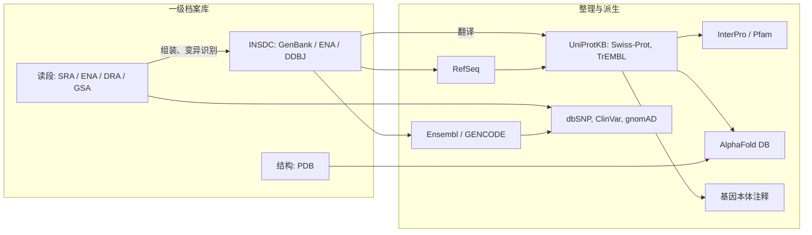

生物信息学中几乎每项分析都从公共数据库开始，又在公共数据库结束：我们比较的序列是别人存入的，用来比对的参考基因组是一条数据库记录，而结果的含义（哪个基因、什么功能、哪种疾病）要从整理过的注释中读出。本章介绍主要的数据库，它们的记录如何标识与版本化，以及基因组上的位置如何命名、如何在参考序列的不同版本之间转换。贯穿全章的例子是 *MCM6* 中的乳糖酶持续性变异 rs4988235（[7.8.1](/7.8.1)）：从一个基因符号出发，找到它的标识符、它在人类基因组两个版本中的位置、它的蛋白质、它的群体频率，以及描述其功能的本体术语。SARS-CoV-2 的基因组则作为完整数据库记录的例子。基因组的组织见 [7.2.2](/7.2.2)，作为生物学问题的基因组注释见 [7.4.14](/7.4.14#sec-14.3)，这些资源背后的数据库系统（**关系模型**、索引、查询）见 [4.13](/4.13)。

## 2.1. 数据库的种类

### 2.1.1. 一级数据库与二级数据库

**定义 2.1.1（一级数据库与二级数据库）** **一级数据库**（档案库）按产生数据的研究者提交的原样存储数据，例如序列、读段或结构及其元数据，只在提交者要求时才更改记录。**二级数据库**由一级数据经过挑选、整理、计算或整合而得，例如非冗余的参考序列集、蛋白质家族，或带临床解释的变异汇编；它的记录由数据库自己的整理人员或流程维护。

这一区分很重要，因为两类数据库回答不同的问题。一级档案库是完整的，忠实于提交者，因此是冗余的，质量参差不齐：同一个基因可能被存入几百次，带有错误，注释也从不更新。二级数据库有所选择并且持续维护，但反映的是整理者的判断。

**定义 2.1.2（INSDC）** **国际核苷酸序列数据库合作组织**（INSDC）是三个一级核苷酸序列档案库的联合运作，它们是 GenBank（美国 NCBI）、欧洲核苷酸档案库（ENA，EMBL-EBI）与日本 DNA 数据库（DDBJ），三者每天交换全部记录，所以提交到其中任何一个的序列，都可以在三者中以同一个登录号获得。

INSDC 也涵盖原始读段，存放在 NCBI 的序列读段档案库（SRA）、ENA 以及 DDBJ 序列读段档案库（DRA）中。中国国家基因组科学数据中心（NGDC）运营的基因组序列档案库（GSA）被期刊认可为等同的存储库；它的人类部分与 dbGaP、欧洲基因组–表型组档案库（EGA）一样，在受控访问下保存个体的人类数据（[7.8.1](/7.8.1#sec-1.6)）。原始读段档案库按记录的层次组织：项目（BioProject，登录号 `PRJNA…`、`PRJEB…`、`PRJCA…`）、它的生物样本（BioSample，`SAMN…`）、对每个样本的测序实验（`SRX…`、`ERX…`），以及每个实验的运行（`SRR…`、`ERR…`、`DRR…`、`CRR…`），最后一层就是被下载的读段文件。

| 种类 | 一级 | 二级 |
|---|---|---|
| 核苷酸序列 | GenBank、ENA、DDBJ（INSDC） | RefSeq、Ensembl 与 GENCODE 注释 |
| 原始读段 | SRA、ENA、DRA、GSA | 表达与变异资源中的处理后数据 |
| 蛋白质序列 | INSDC 编码序列的翻译 | UniProtKB/Swiss-Prot、UniRef 聚类、InterPro、Pfam |
| 结构 | 蛋白质数据库（PDB） | CATH、SCOP；AlphaFold DB（计算得到） |
| 变异 | dbSNP 提交、dbVar | ClinVar 解释、gnomAD 频率 |
| 表达 | GEO、ArrayExpress | Expression Atlas、GTEx 门户 |

### 2.1.2. 记录与标识符

每条记录有一个*登录号*，这是永不重复使用的稳定标识符，还有一个版本：`NC_045512.2` 是登录号 `NC_045512` 的第 $2$ 版。序列本身改变时版本号才增加；只改变注释不改变版本号。引用版本使序列可重复：`NC_000002.11`（GRCh37 的 2 号染色体）上的一个位置与 `NC_000002.12`（GRCh38）上的同一个数字是不同的碱基。

GenBank 平面文件记录由带标签的部分组成：`LOCUS`（名称、长度、分子类型、分类、日期）、`DEFINITION`（一行描述）、`ACCESSION` 与 `VERSION`、`DBLINK`（指向 BioProject 与 BioSample 的链接）、`KEYWORDS`、`SOURCE` 与 `ORGANISM`（含分类谱系）、`REFERENCE`（文献）、`COMMENT`、`FEATURES`（特征表：来源生物与分子、基因、带翻译的编码序列、非翻译区及其他注释元件，每个都有一起始闭区间坐标下的位置），以及 `ORIGIN`，即序列本身。特征表的内容，就是 GFF3 文件（[7.8.1](/7.8.1#sec-1.4.2)）以表格形式编码的东西。

**例 2.1.1（SARS-CoV-2 参考基因组）** 分离株 Wuhan-Hu-1 的基因组，2019 年 12 月从一位患者测序得到，以 `MN908947` 存入 GenBank；其当前版本 `MN908947.3` 是一级记录。NCBI 把它复制到 RefSeq，编号为 `NC_045512.2`，是多数分析使用的参考。该记录描述一个单链正义 RNA 基因组，长 $29\,903$ nt（与所有核苷酸记录一样，写成 DNA）。它的特征表列出长 $265$ nt 的 $5'$ 非翻译区、位于 $266$–$21\,555$ 的大型复制酶基因 `ORF1ab`（翻译为两个多聚蛋白：pp1a，以及通过位置 $13\,468$ 附近的 $-1$ 核糖体移码得到的 pp1ab）、位于 $21\,563$–$25\,384$ 的 spike 基因 `S`，以及其他结构蛋白与辅助蛋白的基因，末尾是位于 $28\,274$–$29\,533$ 的 `N`（核衣壳蛋白）、`ORF10` 和长 $229$ nt 的 $3'$ 非翻译区。病毒的突变相对于这条序列命名：2020 年传遍全球的替换 A23403G，把 spike 蛋白的第 $614$ 位密码子从天冬氨酸变为甘氨酸（D614G），因为 $23\,403 - 21\,563 = 1840 = 3 \times 613 + 1$ 把它定位在第 $614$ 位密码子的第二个碱基。


### 2.1.3. 经过整理的参考集

**定义 2.1.3（RefSeq）** **RefSeq**（NCBI 参考序列数据库）是经过整理的非冗余二级数据库，为一种生物的每个基因组、染色体、转录本与蛋白质提供一条参考记录，由 INSDC 记录导出，NCBI 通过计算维护，其中一部分经过人工审阅。

RefSeq 登录号有两个字母的前缀和一个下划线，前缀说明分子的种类：`NC_` 完整的基因组分子（染色体、细胞器与病毒基因组），`NG_` 基因组区域（用作临床变异命名参考的基因座），`NT_` 与 `NW_` 重叠群与支架，`NM_` 与 `NR_` 经整理的信使 RNA 与非编码 RNA，`NP_` 蛋白质，`XM_`、`XR_`、`XP_` 是基因组注释流程预测、未经完整整理的相应记录。INSDC 登录号没有下划线（`MN908947`）。

**定义 2.1.4（UniProt）** **UniProt**（通用蛋白质资源）是核心的蛋白质序列与注释数据库，由 EMBL-EBI、瑞士生物信息学研究所与蛋白质信息资源中心维护。它的知识库 UniProtKB 有两个部分：*Swiss-Prot*，其条目经整理人员审阅，记录功能、结构域、修饰、变异与文献；以及 *TrEMBL*，条目未经审阅，多半是 INSDC 编码序列的计算翻译，由自动方式注释。

两部分的规模相差几百倍：Swiss-Prot 约有 $5.7\times10^5$ 个条目，TrEMBL 约有 $2.5\times10^8$ 个（2025 年）。为减少搜索中的冗余，UniRef 把 UniProt 序列按 $100\,\%$、$90\,\%$ 与 $50\,\%$ 的一致度聚类。UniProt 登录号如 `Q14566`（人类 MCM6 蛋白，条目名 `MCM6_HUMAN`）是稳定的；条目名可能改变。

## 2.2. 基因组资源

### 2.2.1. 参考基因组

**定义 2.2.1（参考基因组）** **参考基因组**是一个物种的已组装的基因组序列，以带编号的版本（*组装版本*）发布，用作比对读段、命名变异与注释特征的公共坐标系；它代表一个或少数几个个体，不包含该物种的全部序列变异。

人类参考基因组由基因组参考联盟（GRC）维护：

| 组装版本 | UCSC 名称 | 发布 | 说明 |
|---|---|---|---|
| GRCh37 | hg19 | 2009 | 较老的数据集和一些临床流程仍在使用；UCSC 的 hg19 使用了与 GRCh37 修订版剑桥参考序列不同的线粒体序列 |
| GRCh38 | hg38 | 2013 | 当前标准；以不改变主要染色体坐标的*补丁*更新（GRCh38.p14，2022）；包含高变区（如 HLA）的替代位点 |
| T2T-CHM13 | hs1 | 2022 | 第一个所有染色体都没有空缺的组装，来自葡萄胎，2.0 版加入了 HG002 的 Y 染色体（[7.4.14](/7.4.14#sec-14.2.2)） |

用于比对时，主要流程发布的 GRCh38 *分析集*会掩蔽某些区域的重复拷贝（例如 Y 染色体上的拟常染色体区），并加入诱饵序列，如 Epstein–Barr 病毒基因组，使来自污染源的读段不会比对到错误的位置。比对到一个分析集的读段文件，即使在同一组装版本之内，也不能与比对到另一个分析集的文件互换，每项结果都应注明所用参考文件的确切版本。染色体名称也因来源而异：UCSC 文件中是 `chr2` 与 `chrM`，Ensembl 与 NCBI 文件中是 `2` 与 `MT`。

单一的线性参考有其局限（[7.4.14](/7.4.14#sec-14.2.3)）：其中没有的序列是看不见的，来自分化的单倍型的读段比对得很差。人类泛基因组参考联盟在 2023 年发布了由 $47$ 个定相二倍体基因组构成的、以图表示的**泛基因组**参考，基于图的比对见 [7.8.10](/7.8.10) 与 [7.8.11](/7.8.11)。

### 2.2.2. 基因组浏览器与注释集

基因组序列及其注释的三个主要门户是 Ensembl（EMBL-EBI）、UCSC 基因组浏览器与 NCBI（Gene、Genome Data Viewer）。基因组浏览器画出参考坐标轴，其上对齐着*轨道*：基因模型、转录本、保守性、变异、调控元件，以及用户自己的 BED、bigWig、BAM 或 VCF 格式的数据（[7.8.1](/7.8.1#sec-1.4)）。UCSC Table Browser 与 Ensembl 的 BioMart 可以导出某个区域或某个基因列表的任何轨道。

人类基因组使用两套**基因组注释**：GENCODE（与 Ensembl 的注释相同，结合了 HAVANA 小组的人工整理与自动注释）和 RefSeq（由 NCBI 提供）。它们在多数蛋白质编码基因上一致，但每个基因的转录本数目和外显子的确切末端有所不同，这会改变变异的名称与预测效应。MANE 项目（NCBI 与 EMBL-EBI 的匹配注释）为每个蛋白质编码基因定义一条在两套注释中完全相同（直到非翻译区）的 *MANE Select* 转录本，并推荐用它报告临床变异。


### 2.2.3. 基因符号与标识符

人类基因有 HUGO 基因命名委员会（HGNC）指定的认可符号与名称，在每个数据库中还有标识符：

| 符号 | 名称 | HGNC | NCBI Gene | Ensembl 基因 | UniProt | 在此处的角色 |
|---|---|---|---|---|---|---|
| *MCM6* | 微小染色体维持复合物组分 6 | 6949 | 4175 | ENSG00000076003 | Q14566 | 含有乳糖酶增强子 |
| *LCT* | 乳糖酶 | 6530 | 3938 | ENSG00000115850 | P09848 | 增强子的靶基因 |

这些标识符的适用范围不同。符号是给人用的，可以改变（基因的功能更清楚时会修订符号，或为了去掉会被电子表格转成日期的名称，[7.8.1](/7.8.1#sec-1.5.1)），同一个符号在不同物种中也可能指不相关的基因。NCBI Gene 与 Ensembl 基因编号是稳定的机器标识符；Ensembl 编号带版本后缀（`ENSG00000076003.`$n$），基因模型变化时后缀增大。一个基因有多个转录本（`ENST…`、`NM_…`）与蛋白质（`ENSP…`、`NP_…`），所以数据库之间的映射一般是一对多的，给每个基因列出"那个"蛋白质的表格，悄悄地选了其中一个。对人类基因，通过 HGNC 标识符或 MANE Select 转录本映射，可以避免多数歧义。

### 2.2.4. 组装版本之间的坐标转换

新的组装版本会纠正错误、填补空缺，并使坐标移动，有的地方达到兆碱基。一个版本上的数据，必须经过转换才能与另一个版本上的数据合并。

**定义 2.2.2（坐标转换）** **坐标转换**（liftover）是借助两个组装版本（源与目标）之间的全基因组比对，把基因组坐标从一个版本转换到另一个版本；比对存储为*链文件*：一组链，每条链是一串无空位的比对块及块之间的偏移，把源的片段与目标的片段配对，目标片段可能在相反的链上。

**算法 2.2.1（位置的坐标转换）** 输入：染色体 $c$ 上的源位置 $p$，以及 $c$ 上的各条链，每条链带有块的列表 $(s_j, t_j, \ell_j)$，表示源碱基 $[s_j, s_j + \ell_j)$ 与目标碱基 $[t_j, t_j + \ell_j)$ 比对（在目标的正向链上；若链是反向的，则在其反向链上）。

1. 找出含 $p$ 的块，即满足 $s_j \le p < s_j + \ell_j$ 的块：链内的块按 $s_j$ 排序，链本身按区间建立索引，所以对 $B$ 个块用**二分查找**需要 $O(\log B)$ 时间。
2. 若没有块含 $p$，报告失败：该碱基在比对的空位中，即在目标中被删除或重排的区域。
3. 否则，对每个这样的块，目标位置在正向链上为 $t_j + (p - s_j)$，在长为 $T$ 的目标染色体的反向链上为 $T - 1 - (t_j + (p - s_j))$，此时碱基还要取互补。若有几条链含 $p$，该位置映射到几处；工具报告得分最高的链或标出该位置。

区间的转换通过映射它的碱基完成；`liftOver`（UCSC）在至少一定比例的碱基被映射（默认 $95\,\%$）时接受结果，并报告被映射的碱基的范围。跨过空位或链方向改变的区间可能被拆分或拒绝。CrossMap 与 Picard 工具 `LiftoverVcf` 把同样的链应用于 BED、BAM 与 VCF 文件；对 VCF，还必须对照目标序列检查参考等位基因，因为两个组装版本在同一比对位置可能有不同的碱基，此时 REF 与 ALT 要互换。

**例 2.2.1（两个组装版本中的 rs4988235）** 在 GRCh37 中，rs4988235 位于 2 号染色体的位置 $136\,608\,646$；在 GRCh38 中位于 $135\,851\,076$。含它的链块把这一区域平移 $-757\,570$ 个碱基，所以整个 *LCT*–*MCM6* 基因座移动同样的量：例如 *LCT* 在 GRCh37 中约始于 $136.545\,\mathrm{Mb}$，在 GRCh38 中约始于 $135.788\,\mathrm{Mb}$。`rs4988235` 这类标识符不依赖组装版本；这就是交换变异列表时既要给出 rs 编号（或带版本的 RefSeq 记录上的 HGVS 名称）、又要给出位置的原因。


```bash
# Lift a BED file from GRCh37 to GRCh38 with the UCSC chain file
liftOver variants.hg19.bed hg19ToHg38.over.chain.gz variants.hg38.bed unmapped.bed
# The same for a VCF, checking reference alleles against the target genome
CrossMap vcf GRCh37_to_GRCh38.chain.gz variants.grch37.vcf GRCh38.fa variants.grch38.vcf
```

## 2.3. 蛋白质与结构

除 UniProt 之外，还有三种资源更深入地描述蛋白质。**蛋白质数据库**（PDB）是由全球 PDB 合作伙伴（RCSB、PDBe、PDBj、BMRB）运营的、保存实验测定的大分子结构的档案库，约有 $2.3\times10^5$ 个条目（2025 年），每个条目用四个字符的代码标识；MCM2–7 解旋酶（MCM6 是它的一个亚基）的结构就在其中。AlphaFold DB 由 DeepMind 与 EMBL-EBI 构建，为超过 $2\times10^8$ 条 UniProt 序列提供预测结构，附有逐残基的置信度（pLDDT）与预测的比对误差；这些置信度度量的解释是 [7.8.17](/7.8.17) 的一部分。InterPro 整合来自成员数据库的蛋白质家族、结构域与位点的特征，成员之一的 Pfam 的家族由轮廓隐 Markov 模型定义（[7.8.5](/7.8.5)）；例如 MCM 蛋白共有 MCM 结构域，这是一种 AAA+ ATP 酶。结构分类（CATH、SCOP）按折叠与进化关系给结构域分组（[7.1.5](/7.1.5)）。

## 2.4. 变异与表型

| 资源 | 内容 | 例子 |
|---|---|---|
| dbSNP | 带参考 SNP 标识符（`rs`）的短变异，合并提交（`ss`）；超过 $10^9$ 个 `rs` 标识符 | rs4988235、rs334（*HBB* 的镰状细胞等位基因） |
| dbVar、DGV | 结构变异（$> 50\,\mathrm{bp}$） | *AMY1* 基因座的拷贝数变异 |
| ClinVar | 提交的变异与疾病关系的解释，带证据与审阅状态 | *NGLY1* 的致病变异（7.8.12） |
| gnomAD | 来自汇总的外显子组与基因组的分群体等位基因频率（v4：$730\,947$ 个外显子组与 $76\,215$ 个基因组）；每个基因的约束度量 | 必需基因中功能缺失变异的缺乏 |
| GWAS Catalog | 已发表的全基因组关联研究中变异与性状的、经过整理的关联 | rs4988235 与乳糖酶持续性及相关性状的关联 |
| OMIM | 人类基因与孟德尔表型的整理描述；MIM 编号的第一位数字编码基因座（1、2 与 6 常染色体，3 X 连锁，4 Y 连锁，5 线粒体） | 乳糖酶持续性与成人型乳糖酶缺乏 |
| 生物样本库 | 大型队列的基因型与表型数据：UK Biobank（$5\times10^5$ 名参与者）、All of Us（2024 年有基因组数据者超过 $4\times10^5$）、ChinaMAP（首次发布含 $10\,588$ 个深度测序的中国人基因组） | 群体特异的频率 |

**例 2.4.1** 在 1000 Genomes 计划的五个大洲群体中，rs4988235 的 T 等位基因（衍生等位基因，正向链上为 A）的频率在欧洲人中是 $0.52$，在混合美洲人中是 $0.22$，在南亚人中是 $0.11$，在非洲人中是 $0.02$，在东亚人中是 $0.00$。在 Hardy–Weinberg 比例下，欧洲人中至少带一个拷贝、因而预期乳糖酶持续（该等位基因为显性）的比例是 $1 - (1 - 0.52)^2 = 0.77$。在东亚人群中乳糖酶持续性很少见。在非洲与中东的游牧人群中它很常见，但是由同一增强子中的其他变异（如 $-14010\mathrm{G{>}C}$）引起的，这是趋同进化的一个例子，见 [7.4.23](/7.4.23)。

## 2.5. 本体

自由文本的注释（"参与复制"、"DNA 复制"、"DNA 的复制"）无法计数或比较。所以数据库用受控词汇描述功能，词汇中的术语都有定义，并相互关联。

**定义 2.5.1（本体）** 生物信息学中的**本体**是一组术语，每个术语有标识符、名称与定义，术语之间还有带类型的关系（如表示子类的 *is_a* 与 *part_of*），构成**有向无环图**，其中每个术语比它所指向的术语更具体。

**定义 2.5.2（基因本体）** **基因本体**（GO）是基因产物功能的本体，有三个相互独立的方面，每个都是有自己根节点的有向无环图：*分子功能*（GO:0003674；单个基因产物的活性，如 DNA 解旋酶活性，GO:0003678）、*生物过程*（GO:0008150；由若干活性完成的较大过程，如 DNA 复制，GO:0006260）与*细胞组分*（GO:0005575；位置，如 MCM 复合物）。GO *注释*把一个基因产物与一个术语联系起来，附有证据代码与参考文献。

GO 约有 $4\times10^4$ 个术语。由于一个术语可以有多个父项（DNA 修复是一种 DNA 代谢过程，也是细胞对 DNA 损伤反应的一部分），其结构是有向无环图而不是树。注释遵循*真路径规则*：被注释到某个术语的基因产物，也隐含地被注释到它沿 *is_a* 与 *part_of* 关系的所有祖先。所以注释的计数以及与之相关的富集分析（[7.9](/7.9)），必须把每条注释传播到根。

证据代码说明注释如何获得：来自实验（IDA 直接测定、IMP 突变体表型、IPI 物理相互作用、IGI 遗传相互作用、IEP 表达模式），来自高通量实验（HTP 及其子代码），来自系统发生推断（IBA），来自经整理人员审阅的序列相似性（ISS 及相关代码），来自作者或整理人员的陈述（TAS、NAS、IC），或未经审阅的电子方式（IEA）。多数注释，尤其是在模式生物之外，是由相似性转移而来的 IEA；这类注释有用，但会传播错误。

**公式 2.5.1（术语的信息含量）** 若注释集中 $N$ 个基因产物里，经传播后有 $n_t$ 个被注释到术语 $t$，则 $t$ 的信息含量为

$$
\operatorname{IC}(t) = -\log_2\frac{n_t}{N}\ \text{比特}.
$$
Resnik 意义下两个术语的语义相似度，是它们信息含量最大的共同祖先的信息含量。

**例 2.5.1** 在下图的示意注释集中，$100$ 个基因被注释到生物过程的根。传播之后，$8$ 个基因被注释到 DNA 复制起始，$20$ 个到 DNA 复制，$20$ 个到 DNA 修复，$45$ 个到 DNA 代谢过程，$30$ 个到细胞对 DNA 损伤刺激的反应。于是 $\operatorname{IC}(\text{复制起始}) = \log_2(100/8) = 3.64$ 比特，$\operatorname{IC}(\text{DNA 修复}) = 2.32$ 比特。它们信息含量最大的共同祖先是 DNA 代谢过程，所以它们的 Resnik 相似度为 $\log_2(100/45) = 1.15$ 比特；DNA 修复与对 DNA 损伤的反应共有该反应术语（$1.74$ 比特），所以更相似。


本课程使用的其他本体有：序列本体（SO），其术语命名 GFF3 文件的特征类型与变异的后果（`missense_variant`、`splice_donor_variant`，[7.8.12](/7.8.12)）；以及人类表型本体（HPO），含有超过 $1.8\times10^4$ 个临床异常术语，用于描述患者，并在罕见病诊断中给候选基因排序。

## 2.6. 编程访问

网页界面用于浏览；分析则由程序查询数据库。NCBI 的 Entrez E-utilities（`esearch`、`efetch`、`esummary`、`elink`）是覆盖所有 NCBI 数据库的网络服务，没有 API 密钥时限制为每秒 $3$ 次请求，有密钥时为 $10$ 次；Ensembl 的 REST API 为基因、序列、变异、组装版本之间的映射以及变异效应预测返回 JSON（每秒至多 $15$ 次请求）；UniProt 有带查询语言的 REST API。批量数据从 FTP 站点、用 NCBI 的 `datasets` 工具下载，读段则用 SRA Toolkit 下载。

```python
from Bio import Entrez, SeqIO
import requests

Entrez.email = "you@example.org"            # NCBI asks for a contact address
with Entrez.efetch(db="nucleotide", id="NC_045512.2", rettype="gb", retmode="text") as h:
    rec = SeqIO.read(h, "genbank")
spike = [f for f in rec.features if f.type == "CDS" and f.qualifiers.get("gene") == ["S"]][0]
print(spike.location, spike.qualifiers["protein_id"])        # [21562:25384](+) ['YP_009724390.1']

server = "https://rest.ensembl.org"
gene = requests.get(f"{server}/lookup/symbol/homo_sapiens/MCM6",
                    headers={"Content-Type": "application/json"}).json()
print(gene["id"], gene["seq_region_name"], gene["start"], gene["end"], gene["strand"])
mapping = requests.get(f"{server}/map/human/GRCh37/2:136608646..136608646/GRCh38",
                       headers={"Content-Type": "application/json"}).json()
print(mapping["mappings"][0]["mapped"]["start"])              # 135851076
```

Biopython 把 spike 基因的位置报告为 `[21562:25384](+)`，这是零起始半开区间（[7.8.1](/7.8.1#sec-1.4.4)），而 GenBank 记录写作 `21563..25384`。

```bash
# Gene records and sequences with the NCBI datasets tool
datasets download gene symbol MCM6 --taxon human --filename mcm6.zip
# Reads of a sequencing run from the SRA (RUN holds a run accession such as SRR...)
prefetch "$RUN" && fasterq-dump --split-files --threads 8 "$RUN"
```

大型分析不应依赖实时查询，因为数据库更新后它们会返回不同的答案。应下载所用的发布版本（GENCODE 的某个发布、dbSNP 的某个构建、带日期的 UniProt 发布），记录它的版本，并把查询脚本与结果放在一起（[7.8.1](/7.8.1#sec-1.6)）。



## 小结

| 主题 | 要点 |
|---|---|
| 种类 | 一级档案库保存提交的数据；二级数据库整理、计算并整合（定义 2.1.1）；INSDC 每天交换 GenBank、ENA 与 DDBJ（定义 2.1.2）；读段存于 SRA/ENA/DRA/GSA，按项目、样本、实验、运行组织 |
| 标识符 | `accession.version`；序列改变时版本改变；RefSeq 前缀 `NC_`、`NG_`、`NM_`、`NR_`、`NP_`、`XM_`（定义 2.1.3）；UniProt 的 Swiss-Prot（已审阅）与 TrEMBL（定义 2.1.4） |
| 示例记录 | SARS-CoV-2 `NC_045512.2`，$29\,903$ nt，`S` 位于 $21\,563$–$25\,384$；D614G 即 A23403G（例 2.1.1） |
| 参考基因组 | 带版本的坐标系（定义 2.2.1）：GRCh37/hg19、GRCh38/hg38（补丁、替代位点、分析集）、T2T-CHM13；命名 `chr2` 与 `2`；泛基因组图 |
| 注释 | GENCODE/Ensembl 与 RefSeq；MANE Select 转录本；HGNC 符号与稳定编号；映射是一对多的 |
| 坐标转换 | 比对块的链文件（定义 2.2.2）；位置按其所在块的偏移映射，由二分查找找到块（算法 2.2.1）；空位导致失败，反向链翻转链方向，等位基因必须重新检查；rs4988235 移动 $-757\,570$（例 2.2.1） |
| 蛋白质与变异 | PDB、AlphaFold DB、InterPro/Pfam；dbSNP、ClinVar、gnomAD、GWAS Catalog、OMIM、生物样本库；rs4988235 的 T 等位基因在欧洲人中为 $0.52$，在东亚人中为 $0.00$（例 2.4.1） |
| 本体 | 带 is_a/part_of 关系、构成 DAG 的术语（定义 2.5.1）；GO 的三个方面（定义 2.5.2）；真路径规则；证据代码；信息含量与 Resnik 相似度（公式 2.5.1）；SO、HPO |
| 访问 | E-utilities、Ensembl REST、`datasets`、SRA Toolkit；下载并记录发布版本，而不是依赖实时查询 |

## 思考题

1. 为什么 INSDC 即使明知记录中的注释已经过时，仍按提交时的原样保存记录？用户应到哪里查找同一序列的当前注释？

   **答** 一级档案库是科学记录：序列在论文中以登录号引用，若不经提交者就改变它，已发表的分析就无法重复，档案库的整理人员也将不得不去评判每位提交者的数据。因此更正只来自提交者，并以新版本的形式出现。当前的注释在系统地重新注释的二级数据库中：基因组与转录本看 RefSeq 与 Ensembl/GENCODE，蛋白质看 UniProtKB。

2. 临床报告中引用了记录 `NM_005915.6`。标识符的每一部分是什么意思？变为 `NM_005915.7` 意味着什么？

   **答** `NM_` 表示经整理的 RefSeq 信使 RNA，`005915` 是 *MCM6* 转录本记录的登录号，`.6` 是它的第六版。新版本 `.7` 表示转录本的序列变了（例如非翻译区被更正或延长）；以第 $6$ 版计数的 `c.` 记法中的位置，可能与第 $7$ 版上的不同，所以报告必须保留版本号才能被无歧义地解释。

3. 用例 2.1.1 的坐标，核苷酸 $23\,063$ 处的基因组替换（A23063T，几种关注变异株中的 N501Y 突变）位于 spike 蛋白的哪个位置、其密码子的哪个碱基？

   **答** $23\,063 - 21\,563 = 1500 = 3 \times 500 + 0$，所以该碱基是第 $501$ 位密码子的第一个碱基。密码子 AAT（天冬酰胺）变为 TAT（酪氨酸）：N501Y。这与已知的名称一致，是对坐标算术的检验。

4. 一位同事把 $10\,000$ 个变异位置的列表从 GRCh37 转换到 GRCh38，发现有 $40$ 个失败。给出三种失败的原因，并说明应如何处理失败的变异。

   **答** (a) 位置处在链中没有比对块的区域：序列在 GRCh38 中被删除或大幅重排（GRCh37 中的错误被改正）。(b) 位置映射到不止一处，如在片段重复中，工具拒绝选择。(c) 对区间而言，被映射的碱基比例太小，或区间跨过空位或链方向改变。在 VCF 转换中，变异还可能因为两个组装版本的参考碱基不同而被拒绝。失败的变异不应被悄悄丢弃：用 rs 编号查询它们（dbSNP 直接给出 GRCh38 位置），或根据比对到 GRCh38 的读段重新识别，并报告丢失了多少。

5. 为什么把基于 GRCh37 识别的变异 VCF 文件与来自 GRCh38 上 GENCODE 的外显子 BED 文件比较是错误的，即使染色体名称已经统一？估计在 *LCT* 基因座处的误差大小。

   **答** 两个文件使用不同的坐标系：同一个数字表示不同的碱基。在 *LCT* 基因座处偏移为 $757\,570$ 个碱基（例 2.2.1），远大于任何基因，所以变异与外显子之间的重叠基本上是随机的。所有文件必须先转换到同一个组装版本，并在每个文件头中记录组装版本。

6. 取 rs4988235 的 1000 Genomes 等位基因频率 $0.11$，假定 Hardy–Weinberg 比例与显性，计算南亚人群中乳糖酶持续的成人的期望比例。实际比例为什么可能不同？

   **答** $1 - (1 - 0.11)^2 = 1 - 0.7921 = 0.21$。实际比例可能不同，是因为同一增强子中的其他变异在某些人群中也引起乳糖酶持续，因为等位基因频率在南亚各群体之间差异很大（大洲层面的数字对它们做了平均），因为基因型并不完全决定表型（乳糖酶活性逐渐下降，症状取决于肠道微生物与饮食），也因为婚配对人群结构并不是随机的。

7. 在例 2.5.1 的示意注释集中，一次实验的基因列表含有被注释到 DNA 复制起始的 $8$ 个基因中的 $5$ 个，以及其他 $5$ 个基因（共 $100$ 个基因中的 $10$ 个）。随机抽取 $10$ 个基因时，该术语中的期望数是多少？为什么计数必须包括传播后的注释？

   **答** 期望为 $10 \times 8/100 = 0.8$；观察到 $5$ 个提示有富集（富集检验的统计、超几何概率与多重检验见 [7.9](/7.9)）。计数必须包括传播后的注释，因为只被注释到更具体的术语"有丝分裂 DNA 复制起始"的基因，按真路径规则也参与 DNA 复制起始；不做传播，一般性的术语看起来含有的基因会比实际少，对一般性术语的富集就会被低估。

8. 为什么许多分析中把证据代码为 IEA 的注释与 IDA 的区别对待？举例说明 IEA 注释如何传播错误。

   **答** IDA 表示对该基因产物做过直接实验；IEA 表示电子方式的转移，通常来自同源物或结构域特征，没有整理人员审阅。假设某个物种的一个蛋白质被误注释为解旋酶；它在几百个基因组中的同源物通过 IEA 得到同样的注释，而这些注释又支持进一步的转移，于是一个错误变成整个家族的"事实"。检验功能假设的分析常常只限于实验证据，或给它更大的权重。

9. （设计）写出一个小程序的步骤：它从已发表的补充表中取一个人类基因符号列表，对每个基因返回 Ensembl 基因编号、GRCh38 坐标与 MANE Select 转录本。它应当检测出哪些问题？

   **答** 步骤：(1) 规范化符号（去掉空格、转大写），检测日期或数字形式的值（`2-Sep`、`1-Mar`），在没有歧义时把它们映射回 SEPTIN2 或 MARCHF1；(2) 用 HGNC 的下载文件把每个符号映射到 HGNC 标识符，检查以前的符号与别名；报告有歧义（别名为两个基因共有）或未知的符号；(3) 把 HGNC 标识符映射到 Ensembl 基因编号与 NCBI Gene 编号；(4) 查询 GENCODE 或 Ensembl 注释的本地副本（为了可重复，而不用实时 API），得到 GRCh38 上的基因坐标与标记为 MANE Select 的转录本；(5) 报告没有 MANE 转录本的基因（非编码基因、某些基因座），并记录所用发布的版本。应检测的问题是被转换的符号、过时或别名的符号、一对多的映射与缺失的记录。

10. 同一个外显子在 Biopython 中报告为 `[21562:25384]`，在 GenBank 记录中是 `21563..25384`。解释这一差异，并给出两种约定下的长度。

    **答** Biopython 使用 Python 的零起始半开区间，GenBank 使用一起始闭区间；由 [7.8.1](/7.8.1) 的公式 1.4.2，起点相差一，终点相同。长度是 $25\,384 - 21\,562 = 3822$，同样也是 $25\,384 - 21\,563 + 1 = 3822$。
